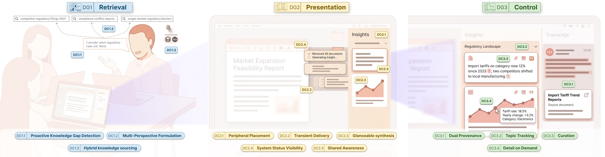
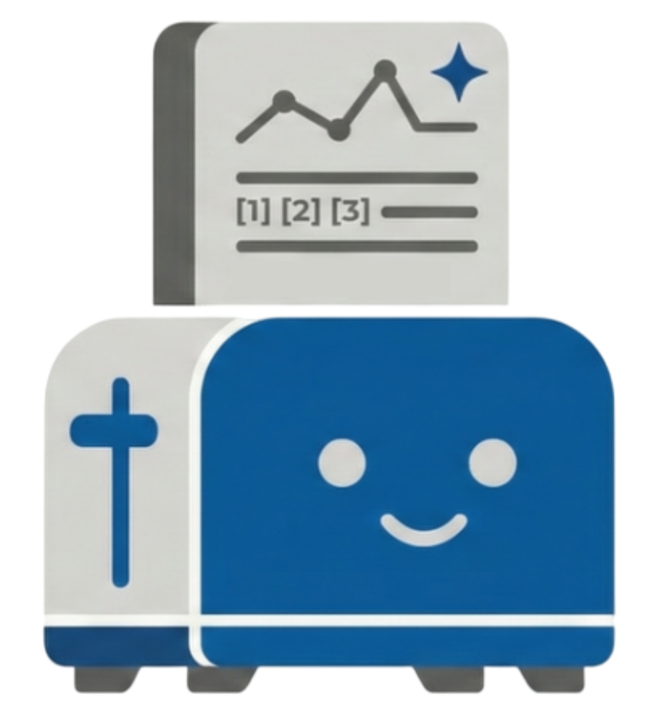

<p align="center">
  
</p>

#  InsightToast

This repository contains the system implementation accompanying the paper:

> **InsightToast: Proactive Information Retrieval & Glanceable Visualization in the Side Channel of Data-Rich Meetings**
> Mohammad Abolnejadian and Matthew Brehmer
> *Proceedings of the 39th Annual ACM Symposium on User Interface Software and Technology (UIST '26)*
> DOI: [10.1145/3830398.3830522](https://doi.org/10.1145/3830398.3830522)

University of Waterloo, UBIX Research Group.

**Live demo:** [insighttoast.vercel.app](https://insighttoast.vercel.app/)

## Abstract

Missing institutional context during meetings can impede effective participation. Retrieving relevant information, often scattered across heterogeneous internal and external sources, requires costly task-switching that disrupts both individual focus and collective conversational flow, particularly detrimental during cognitively demanding tasks such as decision-making. We introduce InsightToast, a mixed-initiative application that monitors verbal discourse in real time, identifies topics and informational needs as they emerge, and proactively retrieves relevant information through a multi-agent large language model (LLM)-based pipeline integrating retrieval-augmented generation (RAG) to produce source-grounded insights as succinct text and glanceable interactive charts, delivered through a peripheral interface as ephemeral toasts in the conversation's side channel. To demonstrate the potential for yielding serendipitous insights, we showcase a usage scenario involving a knowledge base of legislative documents as the meeting's context. We then report on a comparative study (N=16), in which participants arrived at informed policy decisions while maintaining natural conversation flow.

## System overview

InsightToast consists of two components, each documented in its own subdirectory:

- **[`backend/`](backend)**: a FastAPI service that orchestrates a 15-agent LangGraph pipeline. Each incoming transcript chunk is checked for procedural content, assigned to a topic, and assessed for whether it warrants retrieval; when it does, the pipeline formulates queries, retrieves from a Qdrant knowledge base (optionally augmented with web search), and generates a source-grounded text or visualization insight, all streamed back to clients over Server-Sent Events.
- **[`frontend/`](frontend)**: a React application that renders the peripheral interface, live captions, topic threads, and insight cards, and supports both live interactive sessions and a self-contained demo mode.

## Repository structure

```
InsightToast/
├── backend/            # FastAPI application + LangGraph RAG pipeline
├── frontend/            # React user interface
├── assets/              # Images used in this README
├── LICENSE
├── CITATION.cff
└── README.md
```

## Getting started

Each component has its own setup instructions:

1. **[`backend/README.md`](backend/README.md)**: Docker Compose setup for the API, Qdrant, and Ollama, including how to obtain the pre-built knowledge base.
2. **[`frontend/README.md`](frontend/README.md)**: local development setup for the React application.

To try the system without running the backend, install and run the frontend, then navigate to `/demo`; this replays a recorded session with no external dependencies. Running a live interactive session requires both components, a Google Gemini API key, and the parliamentary knowledge base described below.

## Dataset and knowledge base

InsightToast retrieves from a pre-indexed vector knowledge base built from the paper's usage scenario: 43,878 open legislative records from the Canadian House of Commons (1994-2025). The knowledge base, along with the raw and processed source corpus, is released as a supplemental dataset:

**[https://zenodo.org/records/21502545](https://zenodo.org/records/21502545)**

See `backend/README.md` for how to load it into the backend.

## Citation

If you use this system or the accompanying dataset in your work, please cite the paper:

```bibtex
@inproceedings{abolnejadian2026insighttoast,
  author    = {Abolnejadian, Mohammad and Brehmer, Matthew},
  title     = {InsightToast: Proactive Information Retrieval and Glanceable Visualization in the Side Channel of Data-Rich Meetings},
  year      = {2026},
  isbn      = {979-8-4007-2856-3/2026/11},
  publisher = {Association for Computing Machinery},
  address   = {New York, NY, USA},
  doi       = {10.1145/3830398.3830522},
  booktitle = {Proceedings of the 39th Annual ACM Symposium on User Interface Software and Technology},
  series    = {UIST '26},
  location  = {Detroit, MI, USA}
}
```
